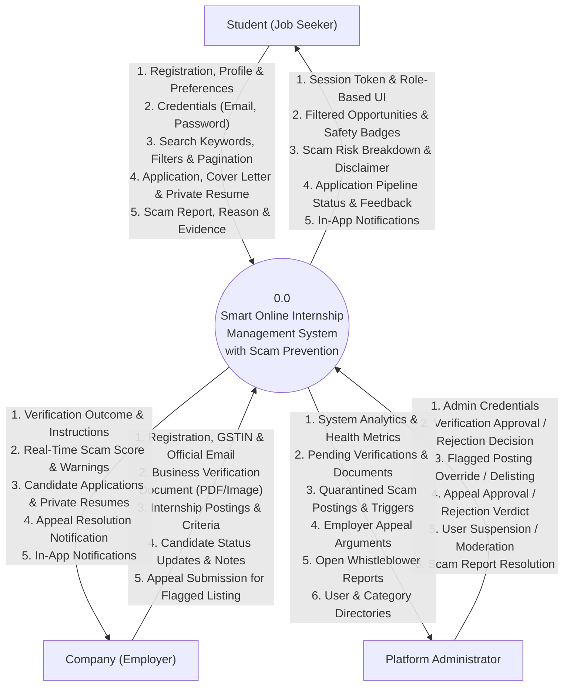

# Data Flow Diagrams (DFD) — Level 0 & Level 1
## Smart Online Internship Management System with Scam Prevention

This document provides the formal Data Flow Diagrams (DFD) for the **Smart Online Internship Management System with Scam Prevention** as required for BCA final-year project documentation and viva defense.

---

### External Entities & System Scope

The system interacts strictly with three authenticated human user roles:
1. **Student:** Candidate seeking verified internship opportunities, managing private resumes, submitting applications, and reporting suspicious postings.
2. **Company (Employer):** Organization registering corporate credentials, undergoing administrative compliance verification, publishing internship openings, and evaluating applicants.
3. **Platform Administrator:** Authority auditing employer credentials, adjudicating quarantined high-risk postings, reviewing company appeals, investigating scam reports, and managing platform taxonomy.

> **Note on External Services:**  
> The system operates as an **independent, self-contained application**. It does **not** rely on external commercial APIs, third-party payment gateways (students never pay for internships on this platform), or external web crawlers. All scam detection runs entirely on-platform using local, deterministic pattern matching and text normalization algorithms in `app/scam_detector.py`.

---

### Level 0: Context Diagram

The Level 0 Context Diagram establishes the boundary of the system, defining external input data flows received from users and corresponding outputs delivered to each role.

---

### Level 1: Data Flow Diagram (Decomposition)

The Level 1 diagram breaks down the central system process into eight core functional modules and connects them to nine concrete database/filesystem data stores:

```mermaid
flowchart TB
    %% External Entities
    subgraph Entities["External Actors"]
        STUDENT["Student"]
        COMPANY["Company"]
        ADMIN["Administrator"]
    end

    %% Processes
    subgraph Processes["System Subsystems & Logic"]
        P1["1.0 User Authentication & Access Control"]
        P2["2.0 Company Verification & Document Audit"]
        P3["3.0 Internship Authoring & Heuristic Scam Screening"]
        P4["4.0 Opportunity Discovery & Multi-Facet Filtering"]
        P5["5.0 Application Intake & Private Resume Storage"]
        P6["6.0 Community Scam Reporting & Auto-Flagging"]
        P7["7.0 Moderation Cascades & Company Appeals"]
        P8["8.0 In-App Notifications Dispatcher"]
    end

    %% Data Stores
    subgraph Stores["Internal Data Stores"]
        D1[("D1: users, student_profiles, companies, admins")]
        D2[("D2: company_verifications & instance/uploads/company_docs")]
        D3[("D3: internship_categories")]
        D4[("D4: internships")]
        D5[("D5: scam_checks (Risk Scores & Rules)")]
        D6[("D6: resumes & instance/uploads/resumes")]
        D7[("D7: applications")]
        D8[("D8: scam_reports")]
        D9[("D9: notifications")]
    end

    %% 1.0 Auth Flows
    STUDENT -->|"Login / Register Data"| P1
    COMPANY -->|"Login / Register Data"| P1
    ADMIN -->|"Admin Login Data"| P1
    P1 <-->|"Validate Credentials & Role"| D1
    P1 -->|"Trigger Welcome Notification"| P8
    P1 -->|"Session & Role Context"| STUDENT
    P1 -->|"Session & Role Context"| COMPANY
    P1 -->|"Session & Role Context"| ADMIN

    %% 2.0 Company Verification Flows
    COMPANY -->|"Upload Verification Doc & GSTIN"| P2
    P2 -->|"Store Document File & Record Status"| D2
    P2 -->|"Update Company Status"| D1
    ADMIN -->|"Review Documents, Approve/Reject"| P2
    P2 -->|"Notify Employer on Outcome"| P8
    P2 -->|"Display Verification Queue"| ADMIN

    %% 3.0 Internship & Scam Detector Flows
    COMPANY -->|"Draft Internship Posting"| P3
    P3 -->|"Fetch Domain Categories"| D3
    P3 -->|"Evaluate Rules (Upfront Fee, Credentials, Stipend, Links, etc.)"| P3
    P3 -->|"Save Active or Flagged Posting"| D4
    P3 -->|"Save Score, Triggered Rules & Disclaimer"| D5
    P3 -->|"Alert Admin if Score >= 61"| P8
    P3 -->|"Live Risk Feedback & Status"| COMPANY

    %% 4.0 Opportunity Discovery Flows
    STUDENT -->|"Keywords, Skills, Duration, Category, Mode"| P4
    P4 <-->|"Read Active Postings"| D4
    P4 <-->|"Read Safety Badges & Risk Disclaimers"| D5
    P4 <-->|"Read Employer Details"| D1
    P4 -->|"Paginated Safe Listings"| STUDENT

    %% 5.0 Application & Resume Flows
    STUDENT -->|"Apply with Resume (PDF/DOCX) & Cover Letter"| P5
    P5 -->|"Store Private Resume in instance/uploads/resumes"| D6
    P5 -->|"Create Unique Application Entry"| D7
    P5 -->|"Notify Employer of Candidate"| P8
    P5 -->|"Notify Student of Submission"| P8
    COMPANY -->|"Update Application Status & Feedback"| P5
    P5 <-->|"Update Pipeline Status"| D7
    P5 -->|"Authorized Resume Serving"| COMPANY
    P5 -->|"Status Tracking"| STUDENT

    %% 6.0 Scam Reporting Flows
    STUDENT -->|"File Scam Report, Reason & Evidence"| P6
    P6 -->|"Insert Open Report"| D8
    P6 -->|"Notify Administrator"| P8
    P6 -->|"Check 3+ Open Reports Threshold"| P6
    P6 -->|"Auto-Quarantine Posting (Status='flagged')"| D4

    %% 7.0 Moderation & Appeals Flows
    COMPANY -->|"Submit Appeal Note"| P7
    P7 -->|"Record Pending Appeal"| D5
    ADMIN -->|"Audit Flagged Postings & Appeals"| P7
    ADMIN -->|"Resolve Whistleblower Reports"| P7
    ADMIN -->|"Block User / Revoke Verification"| P7
    P7 -->|"Update Posting Status (active / closed / rejected)"| D4
    P7 -->|"Update Report Resolution"| D8
    P7 -->|"Close Active Postings Cascade"| D4
    P7 -->|"Notify Affected Student Applicants"| P8
    P7 -->|"Notify Company on Appeal Outcome"| P8

    %% 8.0 Notification Flows
    P8 -->|"Insert In-App Alert"| D9
    D9 -->|"Unread Count & Activity Feed"| STUDENT
    D9 -->|"Unread Count & Activity Feed"| COMPANY
    D9 -->|"Unread Count & Activity Feed"| ADMIN
```

---

### Process Descriptions & Data Transformation Table

| Process ID | Process Name | Primary Inputs | Internal Transformations & Rules | Outputs | Data Stores Involved |
|:---:|:---|:---|:---|:---|:---|
| **1.0** | **User Authentication & Access Control** | Email, password, role choice, next URL | Validates email format, phone format, GSTIN (for companies), hashes passwords via Werkzeug, verifies CSRF token, enforces rate-limiting (5 POST/min per IP), and validates redirect URLs against open-redirect attacks. | Authenticated session cookie, redirection to role dashboard, error messages. | `D1: users, student_profiles, companies, admins` |
| **2.0** | **Company Verification & Document Audit** | Official email, phone, GSTIN, business proof document (PDF, PNG, JPG) | Validates magic bytes/file signatures, isolates document in private instance storage (`instance/uploads/company_docs/`), creates pending verification log. Administrator audits credentials and records approve/reject verdict with feedback. | Verification state transition, audit history, employer approval/rejection notifications. | `D1: companies` `D2: company_verifications` |
| **3.0** | **Internship Authoring & Scam Screening** | Title, description, eligibility, skills, duration, stipend, deadline, instructions | Normalizes leetspeak text, inspects text against 10 weighted rules, handles contextual bounded negations (e.g. "no fee"), calculates composite risk score (0-100). Auto-quarantines postings with score >= 61 into admin review. | Stored posting, scam check score, triggered rule breakdown, advisory disclaimer, admin high-risk alert. | `D3: categories` `D4: internships` `D5: scam_checks` |
| **4.0** | **Opportunity Discovery & Filtering** | Search query, skills keyword, category ID, location type, min/max weeks, page number | Executes parameterized SQLAlchemy queries filtering only active, approved listings; joins category and company data; computes paginated results; attaches safety badges (Low/Medium). | Sanitized HTML listing, pagination links, safety badge tooltips, advisory disclaimer banners. | `D1: companies` `D3: categories` `D4: internships` `D5: scam_checks` |
| **5.0** | **Application Intake & Private Resume Storage** | Cover letter, resume ID or new uploaded resume file (PDF/DOCX) | Verifies file magic bytes (`%PDF` / `PK`), stores file securely in `instance/uploads/resumes/`, enforces candidate uniqueness constraint (`student_id`, `internship_id`), and controls role-based authorization for CV downloads. | Recorded application, updated candidate pipeline, authorized resume download route. | `D6: resumes` `D7: applications` |
| **6.0** | **Community Scam Reporting & Auto-Flagging** | Student report description, reason category, evidence URL, target posting ID | Records student report; checks open report threshold; when 3 or more open reports accumulate against an active posting, automatically flips posting status to `flagged` and quarantines it. | Created `scam_reports` entry, admin scam alert notification, automated quarantine state. | `D4: internships` `D8: scam_reports` |
| **7.0** | **Moderation Cascades & Company Appeals** | Admin moderation actions, delisting options, user blocking, company appeal notes | Records company appeal; enables admin override/restore or permanent rejection. When an employer account is blocked or revoked, cascades closing of all active postings and notifies enrolled student applicants. | Restored or delisted posting, closed posting cascade, applicant notification alerts, updated appeal status. | `D1: users, companies` `D4: internships` `D5: scam_checks` `D7: applications` `D8: scam_reports` |
| **8.0** | **In-App Notifications Dispatcher** | Trigger event (verification, application status, scam warning, appeal verdict) | Dispatches atomic in-app notification records with title, category, deep-link URL, and unread boolean flag. | Reactive navbar alert count badge, notification list view, mark-as-read updates. | `D9: notifications` |
