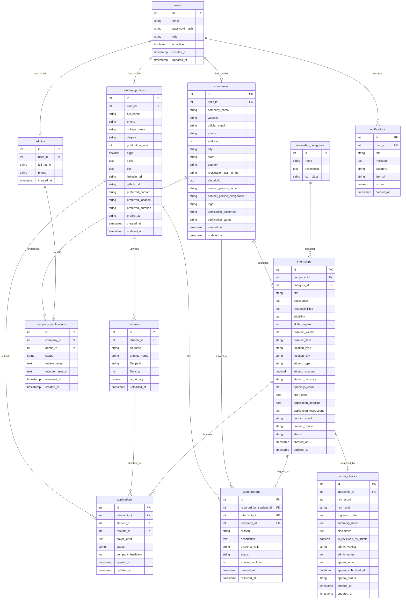

# Entity-Relationship (ER) Diagram
## Smart Online Internship Management System with Scam Prevention

This document provides the complete Entity-Relationship (ER) specification for the database supporting the **Smart Online Internship Management System with Scam Prevention**. The relational database schema is implemented in MySQL 8.0 / 5.7 (InnoDB, UTF-8 Unicode) via SQLAlchemy and raw DDL (`schema.sql`).

---

### Database Table Inventory

The production database comprises exactly **12 tables**, organized across three primary functional domains:
1. **Identity & Role Management (5 tables):** `users`, `admins`, `student_profiles`, `resumes`, `companies`.
2. **Internships, Categorization & Compliance (4 tables):** `company_verifications`, `internship_categories`, `internships`, `scam_checks`.
3. **Engagement, Safety & Workflow (3 tables):** `applications`, `scam_reports`, `notifications`.

---

### Conceptual & Logical ER Diagram (Mermaid)

---

### Detailed Table Data Dictionary

#### 1. `users` (Core Authentication Entity)
*Stores centralized login credentials, user roles, and account active state.*
- `id` (INT, Auto-Increment, **PK**): Unique user account identifier.
- `email` (VARCHAR(150), Unique, Not Null): Login email address (indexed).
- `password_hash` (VARCHAR(255), Not Null): Argon2 / PBKDF2 hashed password string.
- `role` (ENUM('student', 'company', 'admin'), Not Null): Access tier designation (indexed).
- `is_active` (BOOLEAN, Default TRUE): Administrative suspension toggle.
- `created_at` (TIMESTAMP): Registration timestamp.
- `updated_at` (TIMESTAMP): Timestamp of last account modification.

#### 2. `admins` (Administrator Domain)
*Stores administrative profile data linked to a root user account.*
- `id` (INT, Auto-Increment, **PK**): Unique administrator profile identifier.
- `user_id` (INT, Unique, **FK** -> `users.id` ON DELETE CASCADE): Parent user reference.
- `full_name` (VARCHAR(100), Not Null): Administrative officer display name.
- `phone` (VARCHAR(20), Nullable): Contact phone number.
- `created_at` (TIMESTAMP): Account creation timestamp.

#### 3. `student_profiles` (Student Candidate Domain)
*Maintains academic backgrounds, portfolios, and contact details for internship seekers.*
- `id` (INT, Auto-Increment, **PK**): Student profile identifier.
- `user_id` (INT, Unique, **FK** -> `users.id` ON DELETE CASCADE): Associated user account.
- `full_name` (VARCHAR(120), Not Null): Full name of the candidate.
- `phone` (VARCHAR(20), Not Null): 10-digit Indian contact number.
- `college_name` (VARCHAR(200), Nullable): Enrolled college or university.
- `degree` (VARCHAR(100), Nullable): Degree program (e.g. BCA, B.Sc CS, B.Tech).
- `graduation_year` (INT, Nullable): Expected or completed year of passing.
- `cgpa` (DECIMAL(4,2), Nullable): Cumulative Grade Point Average.
- `skills` (TEXT, Nullable): Comma-separated technical and professional competencies.
- `bio` (TEXT, Nullable): Summary background description.
- `linkedin_url` (VARCHAR(255), Nullable): Professional profile hyperlink.
- `github_url` (VARCHAR(255), Nullable): Source code repository portfolio link.
- `preferred_domain` (VARCHAR(100), Nullable): Target industry segment.
- `preferred_location` (VARCHAR(100), Nullable): Target work city or remote preference.
- `preferred_duration` (VARCHAR(50), Nullable): Desired duration (e.g. 2 months, 6 months).
- `profile_pic` (VARCHAR(255), Default 'default_avatar.png'): Static avatar image filename.
- `created_at` (TIMESTAMP): Profile registration time.
- `updated_at` (TIMESTAMP): Profile update time.

#### 4. `resumes` (Candidate Curricula Vitae)
*Tracks uploaded student resume documents stored in private instance storage.*
- `id` (INT, Auto-Increment, **PK**): Resume record identifier.
- `student_id` (INT, **FK** -> `student_profiles.id` ON DELETE CASCADE): Owner student.
- `filename` (VARCHAR(255), Not Null): Unique sanitized filename (`resume_{id}_{hash}.pdf`).
- `original_name` (VARCHAR(255), Not Null): Original filename uploaded by the user.
- `file_path` (VARCHAR(255), Not Null): Storage path (`instance/uploads/resumes/...`).
- `file_size` (INT, Not Null): File payload size in bytes.
- `is_primary` (BOOLEAN, Default TRUE): Default attachment flag for quick applications.
- `uploaded_at` (TIMESTAMP): Upload timestamp.

#### 5. `companies` (Employer Organization Domain)
*Stores organizational identity, official contacts, and government compliance attributes.*
- `id` (INT, Auto-Increment, **PK**): Corporate profile identifier.
- `user_id` (INT, Unique, **FK** -> `users.id` ON DELETE CASCADE): Associated user account.
- `company_name` (VARCHAR(150), Not Null): Legal or operating business name.
- `website` (VARCHAR(255), Nullable): Corporate website URL.
- `official_email` (VARCHAR(150), Not Null): Verified official domain email.
- `phone` (VARCHAR(20), Not Null): Indian telephone or mobile contact number.
- `address`, `city`, `state`, `country` (VARCHAR/TEXT): Physical location details.
- `registration_gst_number` (VARCHAR(50), Nullable): 15-character Indian GSTIN.
- `description` (TEXT, Nullable): Company overview and mission.
- `contact_person_name` (VARCHAR(100), Nullable): HR / Talent acquisition representative.
- `contact_person_designation` (VARCHAR(100), Nullable): Designation of representative.
- `logo` (VARCHAR(255), Default 'default_company.png'): Static logo image filename.
- `verification_document` (VARCHAR(255), Nullable): Private proof of business registration.
- `verification_status` (ENUM('pending', 'approved', 'rejected'), Default 'pending'): Gatekeeper status for internship authoring.
- `created_at`, `updated_at` (TIMESTAMP): Auditing timestamps.

#### 6. `company_verifications` (Administrative Audit Logs)
*Maintains an audit ledger of verification assessments made by system administrators.*
- `id` (INT, Auto-Increment, **PK**): Audit entry identifier.
- `company_id` (INT, **FK** -> `companies.id` ON DELETE CASCADE): Target employer.
- `admin_id` (INT, Nullable, **FK** -> `admins.id` ON DELETE SET NULL): Reviewing officer.
- `status` (ENUM('pending', 'approved', 'rejected')): Review verdict.
- `review_notes` (TEXT, Nullable): Officer commentary or approval conditions.
- `rejection_reason` (TEXT, Nullable): Formal reason provided to the employer if denied.
- `reviewed_at` (TIMESTAMP, Nullable): Timestamp when the review action occurred.
- `created_at` (TIMESTAMP): Timestamp of record logging.

#### 7. `internship_categories` (Domain Taxonomy)
*Lookup table for industry sectors (e.g. Web Development, Data Science, Digital Marketing).*
- `id` (INT, Auto-Increment, **PK**): Category identifier.
- `name` (VARCHAR(100), Unique, Not Null): Human-readable domain name.
- `description` (TEXT, Nullable): Scope definition of the industry domain.
- `icon_class` (VARCHAR(50), Default 'bi bi-briefcase'): Bootstrap icon display class.

#### 8. `internships` (Opportunity Postings)
*Core opportunity table capturing internship specifications, compensation, and safety status.*
- `id` (INT, Auto-Increment, **PK**): Opportunity posting identifier.
- `company_id` (INT, **FK** -> `companies.id` ON DELETE CASCADE): Publishing employer.
- `category_id` (INT, **FK** -> `internship_categories.id`): Domain taxonomy link.
- `title` (VARCHAR(150), Not Null): Role title (e.g., "Full Stack Python Intern").
- `description` (TEXT, Not Null): Detailed job requirements and role overview.
- `responsibilities` (TEXT, Nullable): Itemized tasks.
- `eligibility` (TEXT, Not Null): Minimum qualifications and prerequisites.
- `skills_required` (TEXT, Not Null): Technical stack and prerequisites.
- `duration_weeks` (INT, Default 8): Duration in numeric weeks (1 to 104).
- `duration_text` (VARCHAR(50), Not Null): Human-readable duration (e.g. "8 Weeks").
- `location_type` (ENUM('remote', 'on-site', 'hybrid'), Default 'remote'): Work modality.
- `location_city` (VARCHAR(100), Nullable): City location for on-site or hybrid work.
- `stipend_type` (ENUM('paid', 'unpaid', 'performance-based'), Default 'paid'): Compensation model.
- `stipend_amount` (DECIMAL(10,2), Default 0.00): Monthly compensation amount in INR.
- `stipend_currency` (VARCHAR(10), Default 'INR'): Currency code.
- `openings_count` (INT, Default 1): Number of available seats.
- `start_date` (DATE, Nullable): Projected internship commencement date.
- `application_deadline` (DATE, Not Null): Future deadline date for application intake.
- `application_instructions` (TEXT, Nullable): Specific candidate instructions.
- `contact_email` (VARCHAR(150), Not Null): Point-of-contact email address.
- `contact_phone` (VARCHAR(20), Nullable): Contact phone number.
- `status` (ENUM('active', 'flagged', 'closed', 'rejected'), Default 'active'): Posting lifecycle state.
- `created_at`, `updated_at` (TIMESTAMP): Posting creation and mutation timestamps.

#### 9. `scam_checks` (Automated Risk Assessment Engine Results)
*Captures 1-to-1 automated security audit scores, triggered heuristic rules, and appeal lifecycles.*
- `id` (INT, Auto-Increment, **PK**): Scam check record identifier.
- `internship_id` (INT, Unique, **FK** -> `internships.id` ON DELETE CASCADE): Target posting.
- `risk_score` (INT, Default 0): Aggregate numeric threat index (0 to 100).
- `risk_level` (ENUM('Low', 'Medium', 'High'), Default 'Low'): Safety tier classification.
- `triggered_rules` (LONGTEXT, Not Null): JSON-encoded list of specific rules triggered.
- `summary_notes` (TEXT, Nullable): Generated risk explanation for candidates.
- `disclaimer` (TEXT, Nullable): Standardized platform disclaimer.
- `is_reviewed_by_admin` (BOOLEAN, Default FALSE): Manual admin override indicator.
- `admin_verdict` (ENUM('pending', 'approved', 'rejected'), Default 'pending'): Resolution state.
- `admin_notes` (TEXT, Nullable): Justification written by administrator.
- `appeal_note` (TEXT, Nullable): Formal appeal argument submitted by employer.
- `appeal_submitted_at` (DATETIME, Nullable): Timestamp of appeal lodging.
- `appeal_status` (ENUM('none', 'pending', 'reviewed'), Default 'none'): Appeal workflow status.
- `created_at`, `updated_at` (TIMESTAMP): Record lifecycle timestamps.

#### 10. `applications` (Candidate Submission Records)
*Links student applicants, their chosen private resume, and employer status reviews.*
- `id` (INT, Auto-Increment, **PK**): Application identifier.
- `internship_id` (INT, **FK** -> `internships.id` ON DELETE CASCADE): Applied posting.
- `student_id` (INT, **FK** -> `student_profiles.id` ON DELETE CASCADE): Applying candidate.
- `resume_id` (INT, **FK** -> `resumes.id`): Specific CV document submitted.
- `cover_letter` (TEXT, Nullable): Candidate introductory statement.
- `status` (ENUM('Applied', 'Under Review', 'Selected', 'Rejected', 'Completed'), Default 'Applied'): Application pipeline state.
- `company_feedback` (TEXT, Nullable): Interview outcome or feedback commentary.
- `applied_at` (TIMESTAMP): Application submission time.
- `updated_at` (TIMESTAMP): Pipeline status transition time.
- *Constraint:* `UNIQUE(student_id, internship_id)` prevents duplicate applications to the same opportunity.

#### 11. `scam_reports` (Community Whistleblower Reports)
*Stores reports filed by students identifying fraudulent behavior or off-platform demands.*
- `id` (INT, Auto-Increment, **PK**): Report identifier.
- `reported_by_student_id` (INT, **FK** -> `student_profiles.id` ON DELETE CASCADE): Reporting student.
- `internship_id` (INT, Nullable, **FK** -> `internships.id` ON DELETE CASCADE): Accused posting.
- `company_id` (INT, Nullable, **FK** -> `companies.id` ON DELETE CASCADE): Accused employer.
- `reason` (VARCHAR(150), Not Null): Selected violation category (e.g. "Demanded upfront fee").
- `description` (TEXT, Not Null): Detailed account of suspicious encounter.
- `evidence_link` (VARCHAR(255), Nullable): Link to external screenshots, payment receipts, or chats.
- `status` (ENUM('open', 'investigating', 'resolved', 'dismissed'), Default 'open'): Triage status.
- `admin_resolution` (TEXT, Nullable): Resolution notes documented by administrator.
- `created_at` (TIMESTAMP): Timestamp of report lodging.
- `resolved_at` (TIMESTAMP, Nullable): Timestamp of administrative conclusion.

#### 12. `notifications` (Asynchronous Notification Feed)
*Stores personalized in-app notifications for state changes, warnings, and updates.*
- `id` (INT, Auto-Increment, **PK**): Notification identifier.
- `user_id` (INT, **FK** -> `users.id` ON DELETE CASCADE): Recipient account.
- `title` (VARCHAR(150), Not Null): Bold alert headline.
- `message` (TEXT, Not Null): Explanatory notification body text.
- `category` (ENUM('application', 'verification', 'scam_alert', 'report', 'admin', 'general'), Default 'general'): Semantic category badge.
- `link_url` (VARCHAR(255), Nullable): Actionable deep-link route within the portal.
- `is_read` (BOOLEAN, Default FALSE): Unread tracking flag.
- `created_at` (TIMESTAMP): Generation timestamp.

---

### Cardinality Summary Table

| Relationship | Parent Entity | Child Entity | Cardinality | Constraint / Cascades |
|:---|:---|:---|:---:|:---|
| User Identity | `users` | `admins` | 1 : 0..1 | ON DELETE CASCADE |
| User Identity | `users` | `student_profiles` | 1 : 0..1 | ON DELETE CASCADE |
| User Identity | `users` | `companies` | 1 : 0..1 | ON DELETE CASCADE |
| System Alerts | `users` | `notifications` | 1 : 0..N | ON DELETE CASCADE |
| Student Resumes | `student_profiles` | `resumes` | 1 : 0..N | ON DELETE CASCADE |
| Job Applications | `student_profiles` | `applications` | 1 : 0..N | ON DELETE CASCADE (Unique Pair) |
| Whistleblower Reports | `student_profiles` | `scam_reports` | 1 : 0..N | ON DELETE CASCADE |
| Resume Usage | `resumes` | `applications` | 1 : 0..N | RESTRICT / NO CASCADE |
| Employer Audit | `companies` | `company_verifications` | 1 : 0..N | ON DELETE CASCADE |
| Employer Postings | `companies` | `internships` | 1 : 0..N | ON DELETE CASCADE |
| Employer Reports | `companies` | `scam_reports` | 1 : 0..N | ON DELETE CASCADE |
| Admin Audit | `admins` | `company_verifications` | 1 : 0..N | ON DELETE SET NULL |
| Taxonomy Link | `internship_categories` | `internships` | 1 : 0..N | RESTRICT / NO CASCADE |
| AI / Rule Check | `internships` | `scam_checks` | 1 : 1 | ON DELETE CASCADE (Unique 1:1) |
| Posting Intake | `internships` | `applications` | 1 : 0..N | ON DELETE CASCADE |
| Posting Reports | `internships` | `scam_reports` | 1 : 0..N | ON DELETE CASCADE |
